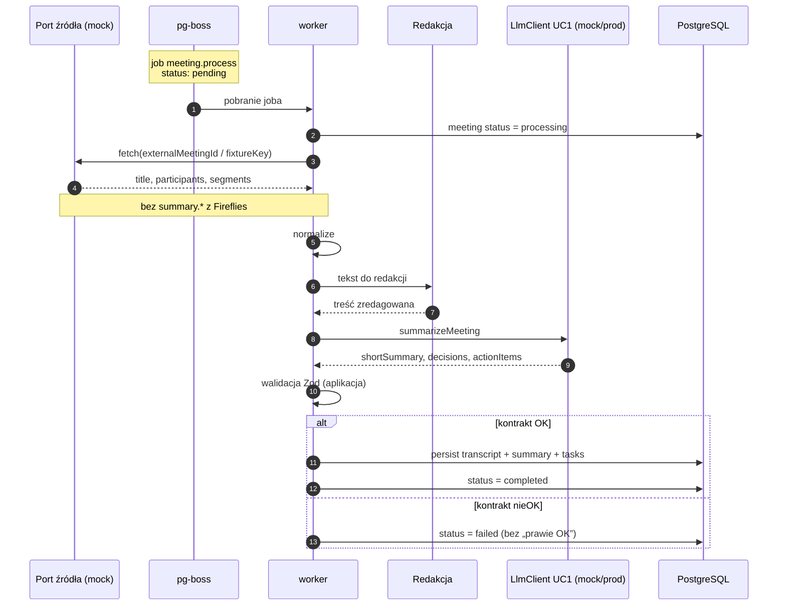
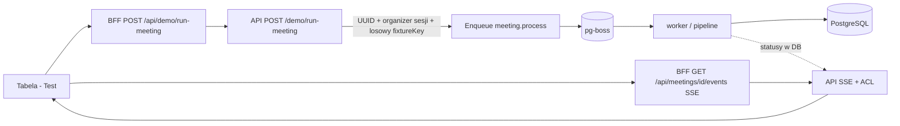
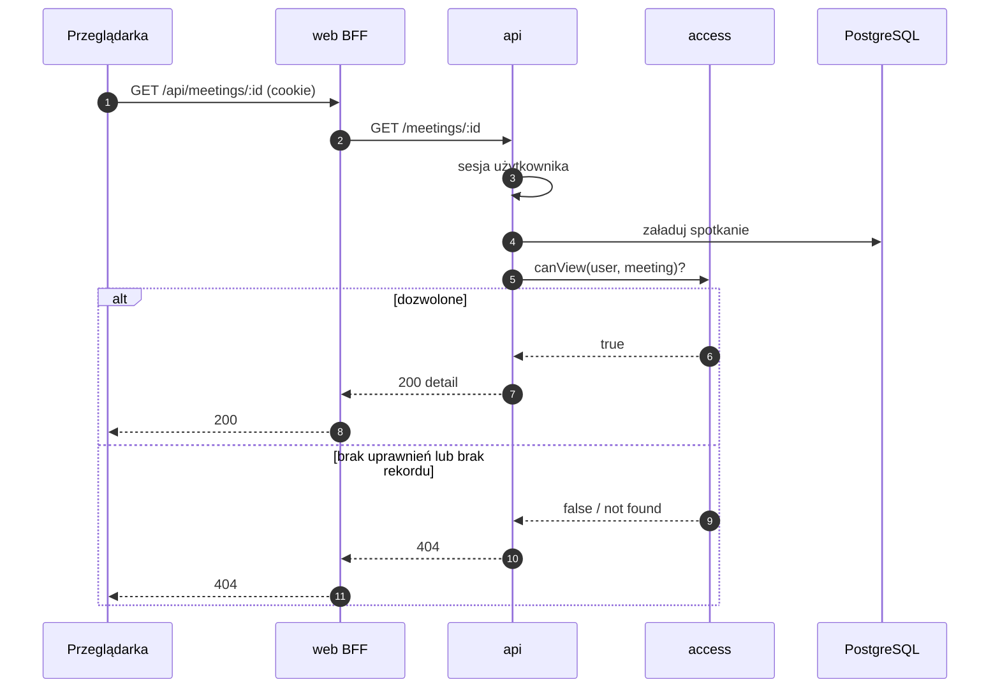
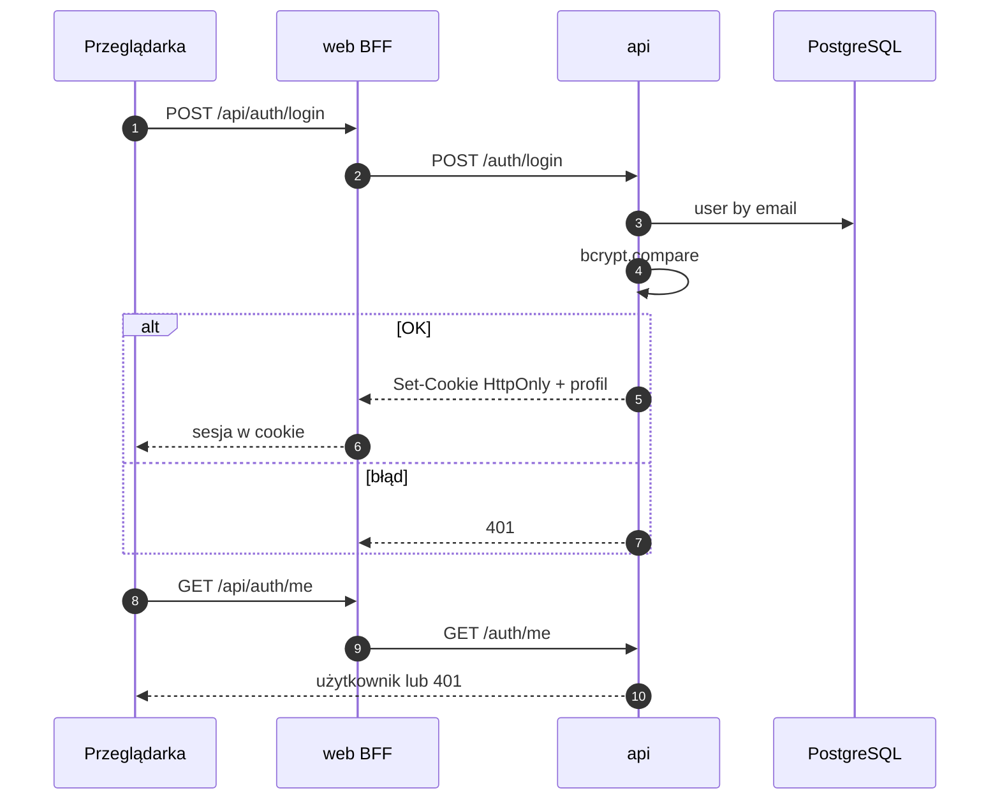
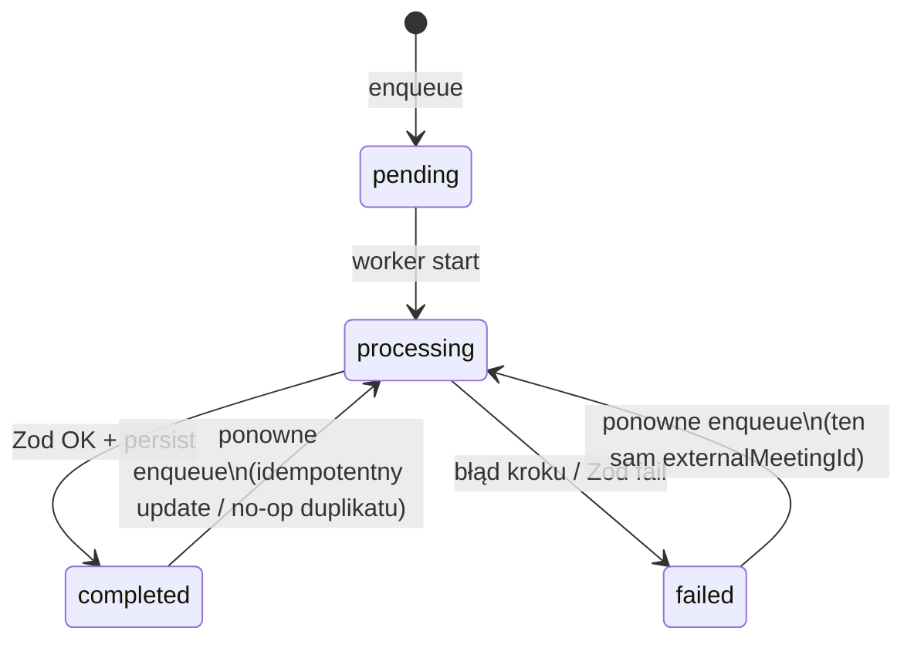
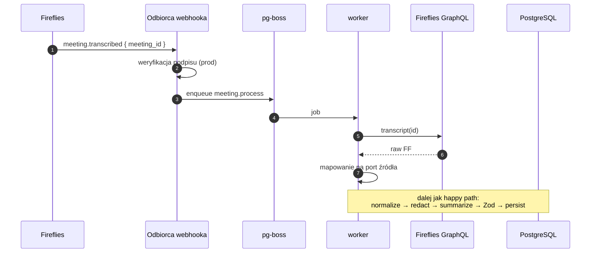
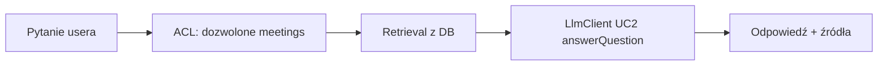

# Przepływy danych

Przepływy Firmowego asystenta spotkań (v1). Poziom szczegółów: kroki, systemy i statusy - bez pełnych payloadów JSON (te są w `dokumentacja_komunikacji.md`).

## 1. Pipeline spotkania (happy path, mock)

Od pojawienia się materiału źródłowego (fixture/mock) do trwałego zapisu zwalidowanego streszczenia.

**Invarianty:** ten sam `externalMeetingId` → co najwyżej jedno kanoniczne spotkanie; niepoprawny wynik summarizera nie nadpisuje sukcesem; **brak** trwałego zapisu transcriptu / summary w DB **przed** wywołaniem LlmClient - wspólny persist dopiero po udanym Zod.

Przy starcie / sukcesie / failu joba worker zapisuje odpowiadające zdarzenia do **`audit_log`** (bez treści transcriptu). Szczegóły: `observability.md`.

## 2. Przycisk Test (PoC na froncie)

UI uruchamia **ten sam** pipeline, nie osobną „fałszywą” ścieżkę. Po enqueue użytkownik **zostaje** na widoku tabeli; statusy płyną przez **SSE**.

**Kontrakt DEMO/Test (tożsamość runu):**

- Każde wywołanie `POST /demo/run-meeting`: API nadaje **nowe** `externalMeetingId` (UUID) oraz ustawia `organizerId` = zalogowany użytkownik sesji.
- Treść mocka: serwer **losuje** `fixtureKey` spośród **katalogu 10** fixture’ów za portem źródła. `fixtureKey` wskazuje **materiał** mocka - **nie** jest kluczem tożsamości wiersza `Meeting` na tej ścieżce.
- **Multi-tester:** kilku użytkowników na jednej instancji - każdy dostaje własne wiersze; ACL (organizator ∨ uczestnik ∨ admin) bez kradzieży cudzych spotkań.
- **Ponowny Test** tego samego użytkownika: **nowy** wiersz `Meeting` (lista może rosnąć) - to akceptowalne zachowanie v1 dema.
- Ścieżka **DX** (`POST /dev/meetings/enqueue` i idempotencja `fixtureKey` ≈ `externalMeetingId`) jest **poza tym kontraktem dema** - bez zmiany w tym dokumencie.

Odpowiedź enqueue: `meetingId`, `jobId`, `status` (zwykle `pending`) - `meetingId` to **własne** spotkanie runu. UI otwiera SSE i aktualizuje **wiersz tabeli** (bez osobnej strony detail w UI v1).

API przy demo zapisuje m.in. `demo.run` oraz `job.enqueued` w **`audit_log`**.

## 3. Odczyt spotkania (z ACL)

Lista `GET /meetings` filtruje zbiór **przed** zwróceniem pozycji (tylko spotkania w ACL). Każdy element listy zawiera projekcję wyniku pod tabelę UI: `summary` oraz `failureReason` (obok metadanych i `processingStatus`) — spójnie z `dokumentacja_komunikacji.md` / `frontend.md`. Dzięki temu odświeżenie widoku domyślnego nie gubi kolumny podsumowania / błędu. Detail (`GET /meetings/:id`) pozostaje bogatszy (np. uczestnicy zewnętrzni); UI v1 nie nawiguje na detail jako głównej ścieżki.

Przy deny API zapisuje `meeting.access.denied` do **`audit_log`** (metadane, bez treści spotkania).

## 4. Auth (login i sesja)

Rejestracja (`POST /auth/register`) to standardowy zapis użytkownika z hasłem po **bcrypt** - bez osobnego diagramu.

Logout czyści cookie po stronie API/BFF zgodnie z konfiguracją. Sukces / failure logowania oraz logout trafiają do **`audit_log`** (bez hasła).

## 5. Awaria w połowie i idempotencja

| Sytuacja | Oczekiwane zachowanie |
|----------|------------------------|
| Crash / awaria **przed** wspólnym persist (po Zod) | Brak kanonicznego transcriptu+summary w DB; status joba / spotkania `failed` lub retry pg-boss; dopuszczalne tylko metadane statusu (`pending` / `processing` / `failed`) - **bez** pół-sukcesu „transcript bez summary”; **bez** drugiego wiersza spotkania przy tym samym `externalMeetingId` |
| Dwukrotny **Test** (DEMO) - nawet przy tym samym wylosowanym `fixtureKey` | **Dwa** wiersze: każde wywołanie ma nowe `externalMeetingId` (UUID); lista użytkownika może rosnąć |
| Ponowne enqueue **tego samego** `externalMeetingId` (retry / DX / prod) | Co najwyżej jedno kanoniczne spotkanie; brak duplikatu biznesowego po kluczu tożsamości |
| Niepoprawny JSON z mocka summarizera | max 1 retry „popraw JSON”; potem `failed`; brak kanonicznego summary „na siłę” |

## 6. Docelowe wejście Fireflies (poza mockiem v1)

Ten sam pipeline od kroku normalize; zmienia się tylko sposób pojawienia się joba i fetch źródła.

Szczegóły pól mapowania: `dokumentacja_komunikacji.md` (sekcja Mapowanie Fireflies).  
`summary.*` FF nie wchodzi do pipeline (decyzja A).

## 7. Asystent Q&A (koncepcja, etap 2+)

Ten sam LlmClient co UC1; inny use case. Nie implementowane w etapie 0.

Szczegóły: `llm_i_asystent.md`.

## Zestawienie: gdzie powstają dane

| Dane | Powstają w | Trafiają do |
|------|------------|-------------|
| Użytkownik + hash hasła | api (register/login) | PostgreSQL |
| Job pipeline | api (demo / prod enqueue) | pg-boss (w Postgres) |
| Transcript znormalizowany + summary + action items | worker (po UC1 + Zod) | PostgreSQL - **jeden** persist po udanej walidacji (nie z FF summary; nie przed LlmClient) |
| Decyzja ACL | api (`access`) | odpowiedź HTTP (organizator ∨ uczestnik ∨ admin); deny → `audit_log` |
| Zdarzenia audytu | api + worker | tabela `audit_log` (retencja 90 dni; odczyt ops/DB) |

## Mapowanie na inne dokumenty

- Kontrakty I/O i kształty: `dokumentacja_komunikacji.md`
- Procesy i porty: `architektura.md`
- UI / przycisk Test: `frontend.md`
- LLM UC1/UC2: `llm_i_asystent.md`
- Audyt zdarzeń: `observability.md`
- Pojęcia: `dictionary.md`
