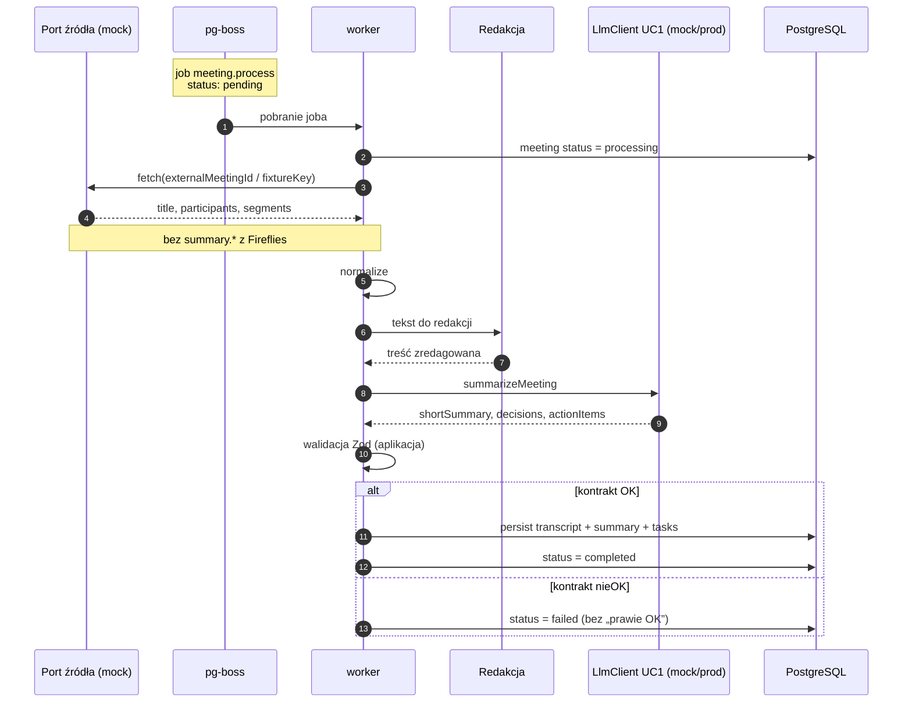
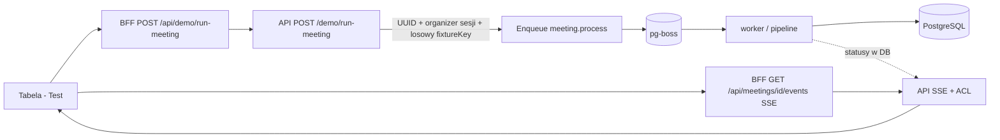
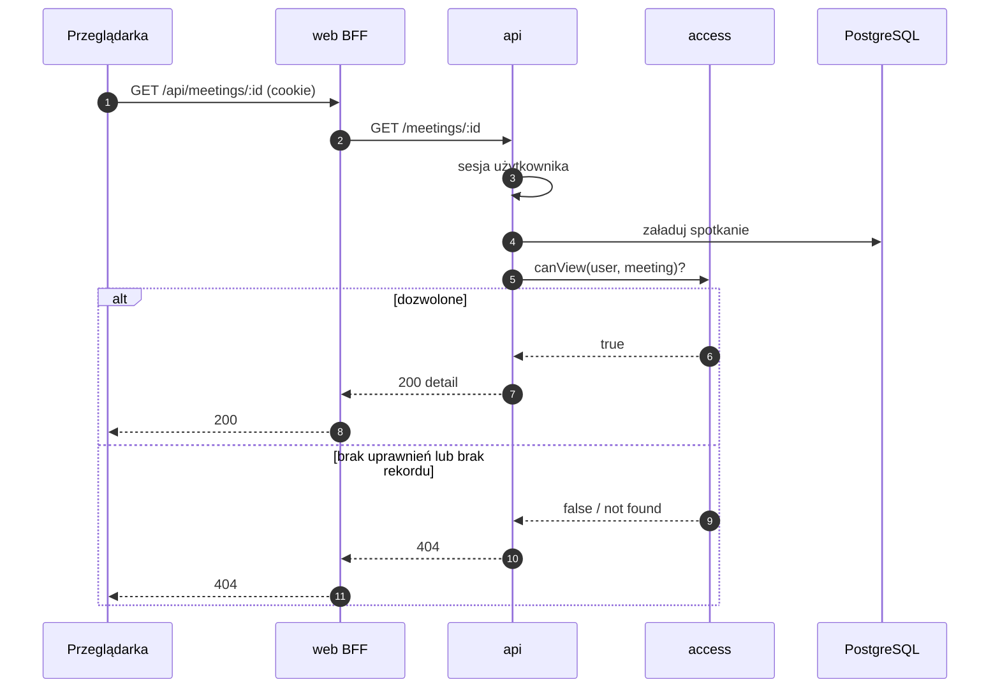
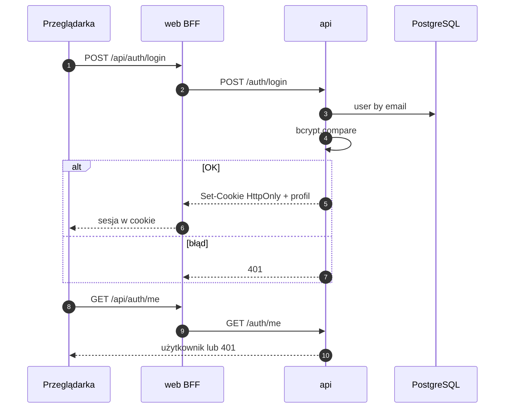
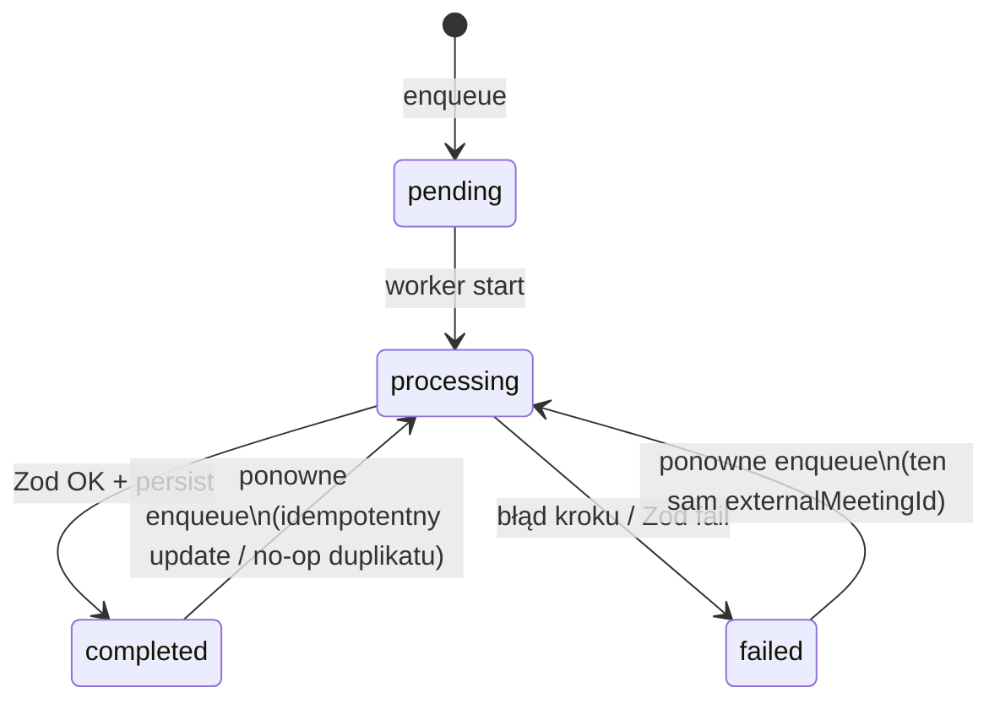
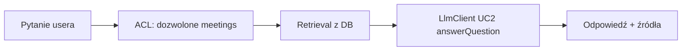

# Przepływy danych

Przepływy Firmowego asystenta spotkań (v1). Poziom szczegółów: kroki, systemy i statusy - bez pełnych payloadów JSON (te są w `dokumentacja_komunikacji.md`).

**Obecna wersja:** happy-path poniżej = mock treści; bez OAuth Google / webhooka Calendar w runtime; zaślepki portów Calendar + `gemini-notes` (major Faza 3.7). **Kolejna wersja / etap 1+:** Calendar → fakt + `description` + uczestnicy; wybór adaptera treści wg `[record-ok]` (`fireflies` \| `gemini-notes`); UC1 gdy treść; metadata-only gdy brak materiału.

## 1. Pipeline spotkania (happy path, mock)

Od pojawienia się materiału źródłowego (fixture/mock) do trwałego zapisu zwalidowanego streszczenia.



**Invarianty:** ten sam `externalMeetingId` → co najwyżej jedno kanoniczne spotkanie; niepoprawny wynik summarizera nie nadpisuje sukcesem; **brak** trwałego zapisu transcriptu / summary w DB **przed** wywołaniem LlmClient - wspólny persist dopiero po udanym Zod.

Przy starcie / sukcesie / failu joba worker zapisuje odpowiadające zdarzenia do **`audit_log`** (bez treści transcriptu). Szczegóły: `observability.md`.

## 2. Przycisk Test (PoC na froncie)

UI uruchamia **ten sam** pipeline, nie osobną „fałszywą” ścieżkę. Po enqueue użytkownik **zostaje** na widoku tabeli; statusy płyną przez **SSE**.

**Kontrakt DEMO/Test (tożsamość runu):**

- Każde wywołanie `POST /demo/run-meeting`: API nadaje **nowe** `externalMeetingId` (UUID) oraz ustawia `organizerId` = zalogowany użytkownik sesji.
- Treść mocka: serwer **losuje** `fixtureKey` spośród **katalogu 10** fixture’ów za portem źródła. `fixtureKey` wskazuje **materiał** mocka - **nie** jest kluczem tożsamości wiersza `Meeting` na tej ścieżce.
- **Multi-tester:** kilku użytkowników na jednej instancji - każdy dostaje własne wiersze; ACL (organizator ∨ uczestnik ∨ admin) bez kradzieży cudzych spotkań.
- **Ponowny Test** tego samego użytkownika: **nowy** wiersz `Meeting` (lista może rosnąć) - to akceptowalne zachowanie v1 dema.
- Ścieżka **DX** (`POST /dev/meetings/enqueue` i idempotencja `fixtureKey` ≈ `externalMeetingId`) jest **poza tym kontraktem dema** - bez zmiany w tym dokumencie.



Odpowiedź enqueue: `meetingId`, `jobId`, `status` (zwykle `pending`) - `meetingId` to **własne** spotkanie runu. UI otwiera SSE i aktualizuje **wiersz tabeli** (bez osobnej strony detail w UI v1).

API przy demo zapisuje m.in. `demo.run` oraz `job.enqueued` w **`audit_log`**.

## 3. Odczyt spotkania (z ACL)



Lista `GET /meetings` filtruje zbiór **przed** zwróceniem pozycji (tylko spotkania w ACL). Każdy element listy zawiera projekcję wyniku pod tabelę UI: `summary` oraz `failureReason` (obok metadanych i `processingStatus`) — spójnie z `dokumentacja_komunikacji.md` / `frontend.md`. Dzięki temu odświeżenie widoku `/meetings` nie gubi kolumny **Wynik** (czytelny `shortSummary` / błąd; bez dumpa JSON). Detail (`GET /meetings/:id`) pozostaje bogatszy (np. uczestnicy zewnętrzni); UI v1 nie nawiguje na detail jako głównej ścieżki.

Przy deny API zapisuje `meeting.access.denied` do **`audit_log`** (metadane, bez treści spotkania).

## 3a. On-demand link nagrania

Kliknięcie buttonu nagrania w UI **nie** zapisuje URL do DB. Przepływ: ACL → resolve URL (v0: mock; etap 1+ **przy zgodzie**: Fireflies) → JSON `{ url }`. Przy **braku zgody** (prod) mechanizm nagrania FF nie jest udostępniany — treść z Notes by Gemini (`bezpieczenstwo_i_rodo.md`).

```mermaid
sequenceDiagram
  autonumber
  participant UI as Przeglądarka
  participant BFF as web BFF
  participant API as api
  participant ACL as access
  participant Port as Port media (mock / FF)
  participant DB as PostgreSQL

  UI->>BFF: GET /api/meetings/:id/recording (cookie)
  BFF->>API: GET /meetings/:id/recording
  API->>API: sesja użytkownika
  API->>DB: załaduj spotkanie (metadane + externalMeetingId)
  API->>ACL: canView(user, meeting)?
  alt dozwolone
    ACL-->>API: true
    API->>Port: resolveRecordingUrl(externalMeetingId)
    Port-->>API: świeży url (v0: atrapa example.com)
    API-->>BFF: 200 { url }
    BFF-->>UI: 200 { url }
    Note over UI: otwarcie url; bez zapisu URL do DB
  else brak uprawnień lub brak rekordu
    ACL-->>API: false / not found
    API-->>BFF: 404
    BFF-->>UI: 404
  end
```

**Invarianty:** brak kolumny ephemeral media URL na `Meeting`; ten sam kontrakt HTTP przy podmianie mock → FF; docelowo widoczność buttonu wg `[record-ok]` (`bezpieczenstwo_i_rodo.md`) — w v0 button zawsze widoczny (demo).

## 4. Auth (login i sesja)

**Etap 0:** rejestracja (`POST /auth/register`) to standardowy zapis użytkownika z hasłem po **bcrypt** - bez osobnego diagramu. Poniżej: login e-mail/hasło.



Logout czyści cookie po stronie API/BFF zgodnie z konfiguracją. Sukces / failure logowania oraz logout trafiają do **`audit_log`** (bez hasła).

**Etap 1+ (koncepcja):** zamiast (lub obok) hasła — start OAuth Google Workspace → callback → find-or-create `User` po firmowym e-mailu → **te same** Set-Cookie sesji. Integracja Calendar używa **osobnych** credentials; ACL odczytu spotkań bez zmian (`dokumentacja_koncepcyjna.md`).

## 5. Awaria w połowie i idempotencja



| Sytuacja | Oczekiwane zachowanie |
|----------|------------------------|
| Crash / awaria **przed** wspólnym persist (po Zod) | Brak kanonicznego transcriptu+summary w DB; status joba / spotkania `failed` lub retry pg-boss; dopuszczalne tylko metadane statusu (`pending` / `processing` / `failed`) - **bez** pół-sukcesu „transcript bez summary”; **bez** drugiego wiersza spotkania przy tym samym `externalMeetingId` |
| Dwukrotny **Test** (DEMO) - nawet przy tym samym wylosowanym `fixtureKey` | **Dwa** wiersze: każde wywołanie ma nowe `externalMeetingId` (UUID); lista użytkownika może rosnąć |
| Ponowne enqueue **tego samego** `externalMeetingId` (retry / DX / prod / **Aktualizuj źródło**) | Co najwyżej jedno kanoniczne spotkanie; brak duplikatu biznesowego po kluczu tożsamości |
| Niepoprawny JSON z mocka summarizera | max 1 retry „popraw JSON”; potem `failed`; brak kanonicznego summary „na siłę” |

### 5a. Aktualizuj źródło (etap 1+; recovery niepełnego rekordu)

Gdy pierwsza próba kończy się **metadata-only** (albo `failed` przy pustym / niedostępnym źródle), a użytkownik wie, że u vendora treść już jest (Notes dogoniły, share Drive, FF skończył transcript):

```mermaid
sequenceDiagram
  autonumber
  participant UI as Panel
  participant API as api
  participant Q as pg-boss
  participant W as worker
  participant Cal as Calendar
  participant Src as Adapter treści
  participant DB as PostgreSQL

  UI->>API: POST /meetings/:id/reprocess (Aktualizuj)
  Note over API: ACL jak detail; tylko enqueue
  API->>Q: meeting.process (ten sam externalMeetingId)
  API-->>UI: meetingId + status pending
  Q->>W: job
  W->>Cal: świeże metadane / description
  W->>Src: ponowny fetch treści
  alt nowy materiał tekstowy
    Note over W,DB: redact → UC1 → Zod → update in place
  else nadal brak treści
    Note over W,DB: zostaje / wraca metadata-only;<br/>bez kasowania istniejącego kanonu (upgrade-only)
  end
```

| Reguła | Norma |
|--------|--------|
| Mechanizm | Ten sam job `meeting.process` + klucz `externalMeetingId` — **nie** osobny typ „sync Google” |
| HTTP | Synchronicznie tylko ACL + enqueue; I/O vendora w workerze |
| Kiedy UI | Głównie metadata-only / `failed`; opcjonalnie admin force; debounce (np. 1× / N min) |
| Treść | Upgrade-only: pojawienie się transcriptu → zapis + UC1; pusty re-fetch **nie** kasuje istniejącego summary/transcriptu |
| Nagranie FF | Poza jobem; nadal `GET .../recording` (on-demand). „Aktualizuj” **nie** pobiera ani nie persistuje pliku audio/video |
| Gałąź bez `[record-ok]` | Tylko ponowna próba Notes / tekstu; bez audio FF |

Szczegóły kontraktu HTTP / UI: `dokumentacja_komunikacji.md`, `frontend.md`. Norma: `spec/SPEC-PIPELINE`, `SPEC-KOMUNIKACJA`, `SPEC-FRONTEND`.

## 6. Docelowe wejście (etap 1+; poza mockiem / zaślepką v0)

Ten sam pipeline od kroku normalize; zmienia się sposób pojawienia się joba, źródło **metadanych** i wybór adaptera **treści**.

```mermaid
sequenceDiagram
  autonumber
  participant Cal as Google Calendar
  participant Src as Adapter treści<br/>fireflies / gemini-notes
  participant Q as pg-boss
  participant W as worker
  participant DB as PostgreSQL

  Note over Cal,W: metadane faktu zawsze z Calendar<br/>tag [record-ok] w description
  Cal-->>W: title, czas, description, uczestnicy
  alt description zawiera [record-ok]
    Src->>Src: fireflies (transcript + media u FF)
  else brak [record-ok]
    Src->>Src: gemini-notes (tekst; bez audio FF)
  end
  Q->>W: meeting.process
  W->>Src: fetch treści
  alt jest materiał tekstowy
    Note over W,DB: normalize → redact → UC1 → Zod → persist
  else brak / pusty materiał
    W->>DB: metadata-only (bez AI)
  end
```

Gałąź z `[record-ok]` (FF webhook + GraphQL): szczegóły pól — `dokumentacja_komunikacji.md` (Mapowanie Fireflies); `summary.*` FF nie wchodzi do pipeline. On-demand nagranie FF — tylko przy `[record-ok]` (sekcja 3a). Sygnał tagu: `calendarDescriptionAllowsRecording` (`@vinseo/contracts`).

## 7. Asystent Q&A (koncepcja, etap 2+)

Ten sam LlmClient co UC1; inny use case. Nie implementowane w etapie 0.



Szczegóły: `llm_i_asystent.md`.

## Zestawienie: gdzie powstają dane

| Dane | Powstają w | Trafiają do |
|------|------------|-------------|
| Użytkownik + hash hasła | api (register/login) | PostgreSQL |
| Job pipeline | api (demo / prod enqueue) | pg-boss (w Postgres) |
| Transcript znormalizowany + summary + action items | worker (po UC1 + Zod) | PostgreSQL - **jeden** persist po udanej walidacji (nie z FF summary; nie przed LlmClient) |
| Decyzja ACL | api (`access`) | odpowiedź HTTP (organizator ∨ uczestnik ∨ admin); deny → `audit_log` |
| Ephemeral URL nagrania | api (on-demand; mock / później FF) | tylko odpowiedź JSON `{ url }` — **nie** Postgres |
| Zdarzenia audytu | api + worker | tabela `audit_log` (retencja 90 dni; odczyt ops/DB) |

## Mapowanie na inne dokumenty

- Kontrakty I/O i kształty: `dokumentacja_komunikacji.md`
- Procesy i porty: `architektura.md`
- UI / przycisk Test / Aktualizuj źródło: `frontend.md`
- LLM UC1/UC2: `llm_i_asystent.md`
- Audyt zdarzeń: `observability.md`
- Pojęcia: `dictionary.md`
